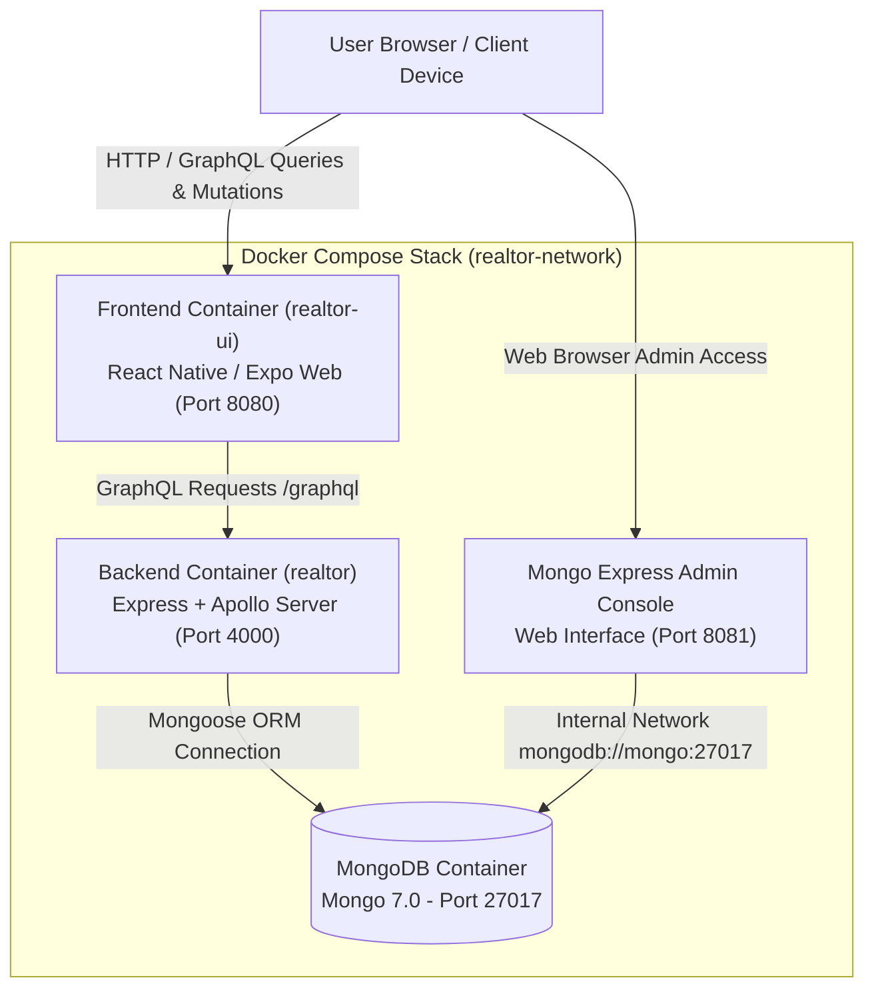

# Realtor Application - Scaffold Architectural Overview

## 1. Executive Summary

The **Realtor** application is a modern, full-stack real estate platform built with TypeScript across all tiers. The scaffold provides a modular, containerized architecture featuring a React Native / Expo web-first frontend, a GraphQL (Apollo Server + Express) backend API, MongoDB persistence, and an integrated web-based database management interface via Mongo Express.

---

## 2. High-Level System Architecture



---

## 3. Technology Stack & Key Components

### A. Frontend Tier (`realtor-ui/`)
- **Framework**: React Native / Expo (Web-first build served via Nginx in production container, or Expo dev server with Fast Refresh in development mode)
- **UI & Design System**: Tamagui UI (themeable, responsive component system)
- **Data Fetching & State**: Apollo Client (`@apollo/client`, `graphql`)
- **Testing**: `jest`, `jest-expo`, `@testing-library/react-native`, and Playwright for E2E user flow tests

### B. Backend Tier (`realtor/`)
- **Runtime**: Node.js with TypeScript
- **Server Platform**: Express + Apollo Server (GraphQL API endpoint at `/graphql`)
- **Data Access & Modeling**: Mongoose ORM
- **Testing**: `jest` and `ts-jest` with strict **90% code coverage requirement**

### C. Database & Administration
- **Database**: MongoDB 7 (`realtor-mongo` container on port 27017)
- **Admin Interface**: Mongo Express (`realtor-mongo-express` container on port 8081)

### D. Infrastructure & Containerization
- **Orchestration**: Docker & Docker Compose (`docker-compose.yml` for production, `docker-compose.dev.yml` for instant hot-reloading development)
- **Networking**: Isolated bridge network (`realtor-network`)
- **Storage**: Persistent volume `mongo_data` mounted to `/data/db`

---

## 4. Database Administration & Mongo Express Access

Mongo Express is integrated into the Docker Compose stack to allow developers and administrators to visually inspect and manage MongoDB database collections.

### Access Instructions
- **Web UI URL**: [http://localhost:8081](http://localhost:8081)
- **Container Name**: `realtor-mongo-express`
- **Port Mapping**: Host `8081` -> Container `8081`
- **Authentication**: Disabled for local development (`ME_CONFIG_BASICAUTH=false`)
- **Connected Database Server**: `mongodb://mongo:27017`

---

## 5. Repository Structure

```
Realtor/
├── Product/                      # Documentation & Architecture Specifications
│   └── architecture-overview.md  # Architectural overview document
├── realtor/                      # Backend Service (Node.js / Express / GraphQL)
│   ├── src/
│   │   ├── config/               # Database & Environment Configuration
│   │   ├── schema/               # GraphQL Type Definitions & Resolvers
│   │   ├── index.ts              # Entry point
│   │   └── server.ts             # Express & Apollo Server initialization
│   ├── tests/                    # Unit and integration test suites
│   ├── Dockerfile                # Production backend container definition
│   ├── jest.config.ts            # Test configuration (90% coverage enforced)
│   └── package.json
├── realtor-ui/                   # Frontend Service (React Native / Expo Web)
│   ├── src/
│   │   ├── apollo/               # Apollo Client setup & GraphQL queries
│   │   └── components/           # UI Components (Tamagui)
│   ├── e2e/                      # Playwright End-to-End tests
│   ├── tests/                    # Component & UI test suites
│   ├── App.tsx                   # Main React Native application root
│   ├── Dockerfile                # Multi-stage Nginx build definition (production)
│   ├── Dockerfile.dev            # Development build with hot reloading support
│   ├── tamagui.config.ts         # Design system configuration
│   └── package.json
├── AGENTS.md                     # Agent Governance & Operational Guidelines
├── docker-compose.yml            # Production services orchestration
├── docker-compose.dev.yml        # Development orchestration with live bind-mounts
└── package.json                  # Root project scripts
```

---

## 6. Development Workflows & Hot Reloading

### Instant Hot-Reloading Development Mode (`docker-compose.dev.yml`)
To make changes to JavaScript (`.js`) or TypeScript (`.ts`, `.tsx`) files reflect immediately in the running containers without rebuilding:

```bash
# Spin up development containers with host bind-mounts
docker-compose -f docker-compose.dev.yml up -d --build
```
- **Backend Hot Reloading**: Host directory `./realtor/src` is mounted to `/app/src`. `nodemon` monitors `.ts` file edits and reloads the Node server within **~100ms**.
- **Frontend Fast Refresh**: Host directory `./realtor-ui/src` is mounted to `/app/src`. Expo Web dev server streams live UI component updates directly to the browser in real time.

### Production Stack Mode (`docker-compose.yml`)
For production deployment or final validation:
```bash
# Build and launch production containers (Nginx static bundle + compiled Node dist)
docker-compose up -d --build
```

---

## 7. Testing Standards & Quality Gates

The codebase strictly enforces the testing pyramid across all layers as governed by `AGENTS.md`:

| Test Layer | Target Scope | Framework | Coverage Requirement |
| :--- | :--- | :--- | :--- |
| **Unit Testing** | Backend logic, resolvers, models, hooks | `jest`, `ts-jest` | **90% Minimum** (Statements, Branches, Functions, Lines) |
| **UI / Component Testing** | Component rendering, visual states, Tamagui themes | `jest`, `jest-expo`, `@testing-library/react-native` | Verified via test runner |
| **End-to-End (E2E)** | Full user journeys, real browser interaction, GraphQL data flows | `@playwright/test` | Automated browser suite |

---

## 8. Access Points Summary

- **Frontend App**: [http://localhost:8080](http://localhost:8080)
- **GraphQL API Endpoint**: [http://localhost:4000/graphql](http://localhost:4000/graphql)
- **Mongo Express Admin Console**: [http://localhost:8081](http://localhost:8081)
- **MongoDB Connection String**: `mongodb://localhost:27017/realtor`
