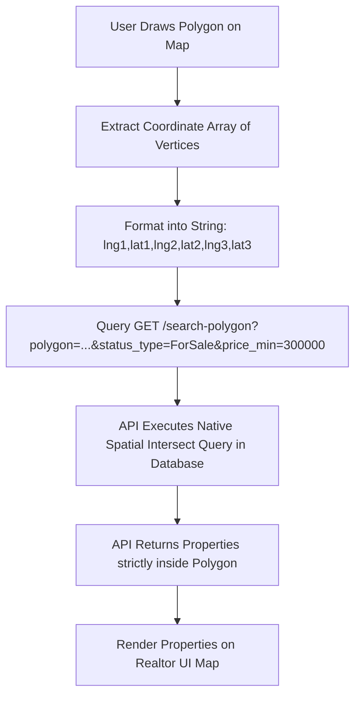

# RapidAPI Real-Time Real Estate Data API Technical Research Report

**Date:** August 24, 2026  
**Target Application:** Realtor Platform  
**File Location:** `Product/real-time-real-estate-data-api-report.md`  
**API Provider:** OpenWeb Ninja / `letscrape-6bRBa3QguO5` on RapidAPI  
**RapidAPI Endpoint Host:** `real-time-real-estate-data.p.rapidapi.com`  

---

## 1. Executive Overview & Authentication

The **Real-Time Real Estate Data API** (by OpenWeb Ninja / `letscrape-6bRBa3QguO5`) provides comprehensive, live real estate listing and property attribute data across both **Canada** and the **United States**. 

Unlike US-only data providers (such as RentCast), this API offers full cross-border coverage, including major Canadian metropolitan areas (e.g., Toronto, Vancouver, Montreal, Calgary, Ottawa) and Canadian Forward Sortation Areas / Postal Codes (e.g. `M5V 2T6`).

### Base Specifications
* **RapidAPI URL:** `https://real-time-real-estate-data.p.rapidapi.com`
* **Protocol:** HTTPS GET / JSON Response
* **Authentication:** RapidAPI HTTP Headers:
  ```http
  X-RapidAPI-Key: YOUR_RAPIDAPI_KEY
  X-RapidAPI-Host: real-time-real-estate-data.p.rapidapi.com
  ```
* **Content-Type:** `application/json`
* **Geographic Scope:** **Canada (CA)** & **United States (US)**

---

## 2. Available API Endpoints Inventory

The API provides a set of endpoints for property search, polygon geofencing, property inspection, agent prospecting, and market metrics:

| Endpoint | Method | Description |
| :--- | :--- | :--- |
| `/search` | `GET` | Location search for active or sold property listings by city, state/province, or zip/postal code. |
| `/search-polygon` | `GET` | **Native Polygon Search**: Retrieve property listings residing strictly within a custom polygon boundary. |
| `/search-bounding-box` | `GET` | Search property listings within rectangular coordinate bounds (`north`, `south`, `east`, `west`). |
| `/property-detail` | `GET` | Full property inspection (high-res photos, structural specs, price history, tax assessments, school scores, AVM/Zestimates). |
| `/auto-complete` | `GET` | Geocoding and address/location autocomplete search suggestions. |
| `/agent-search` | `GET` | Search real estate agents and broker profiles by name or geographic region. |
| `/agent-properties-for-sale` | `GET` | Retrieve active for-sale listings associated with a specific agent ID. |
| `/agent-properties-sold` | `GET` | Retrieve historical sold listings associated with a specific agent ID. |
| `/market-trends` | `GET` | Aggregate market analytics, median listing prices, price per sq ft, and average days on market by region. |

---

## 3. For-Sale Property Search & Polygon Filtering Analysis

### A. Searching For-Sale Properties
The API features dedicated endpoints for searching for-sale, for-rent, and sold properties in both **Canada** and the **US**.

#### Supported Filter Criteria & Parameters:
1. **Location Parameters:**
   * `location` *(string)*: City, Province/State, or Postal Code (e.g. `Toronto, ON`, `Vancouver, BC`, `M5V 2T6`, `Seattle, WA`).
   * `polygon` *(string)*: Used in `/search-polygon` for custom spatial boundaries.

2. **Listing Status & Property Type Filters:**
   * `status_type` *(enum)*: Filter by market status (`ForSale`, `ForRent`, `Sold`, `Pending`, `ComingSoon`). Default is `ForSale`.
   * `home_type` *(string)*: Comma-separated property types (`Houses`, `Townhomes`, `Condos`, `Multi-family`, `Apartments`, `LotsLand`, `Manufactured`).

3. **Numeric & Characteristic Filters:**
   * `price_min` / `price_max` *(number)*: Minimum and maximum listing price (e.g., `price_min=400000&price_max=1200000`).
   * `beds_min` / `beds_max` *(number)*: Bedroom count range (e.g., `beds_min=2`).
   * `baths_min` / `baths_max` *(number)*: Bathroom count range (e.g., `baths_min=2`).
   * `sqft_min` / `sqft_max` *(number)*: Living area size in square feet range.
   * `year_built_min` / `year_built_max` *(number)*: Construction year range.
   * `days_on_zillow` / `days_on_market` *(number)*: Filter listings posted within the last N days (e.g. `days_on_market=7`).

4. **Sorting & Pagination:**
   * `sort` *(enum)*: `Homes_For_You`, `Price_High_Low`, `Price_Low_High`, `Newest`, `Bedrooms`, `Bathrooms`, `Square_Feet`.
   * `page` *(number)*: Pagination page number (default `1`).

---

### B. Polygon Geo-Filtering Evaluation

> [!IMPORTANT]
> **Does this API support searching based on Geo Polygons natively?**  
> **YES!** Unlike RentCast (which only supports circular radius searches), the Real-Time Real Estate Data API includes a dedicated **`GET /search-polygon`** endpoint that natively executes spatial polygon queries.

#### Polygon Coordinate Parameter Format
When querying `GET /search-polygon`, pass the custom boundary via the `polygon` query parameter:

* **Format:** Comma-separated list of `longitude,latitude` coordinate pairs:
  ```http
  polygon="lng1,lat1,lng2,lat2,lng3,lat3..."
  ```
* **Coordinate Order:** `longitude, latitude` (X, Y order).
* **Closing:** A minimum of 3 coordinate pairs is required. The API automatically connects the last vertex to the first vertex to close the polygon loop.

#### Example Canadian Polygon Coordinate String:
```http
polygon="-79.3900,43.6450,-79.3750,43.6550,-79.3700,43.6400"
```
*(Represents a polygon enclosing Downtown Toronto / Fashion District, Ontario, Canada)*.

#### Workflow Diagram:


---

### C. Comparison: RentCast vs. RapidAPI Real-Time Real Estate Data API

| Feature | RentCast API | RapidAPI Real-Time Real Estate Data API |
| :--- | :--- | :--- |
| **Geographic Coverage** | 🇺🇸 United States ONLY | 🇨🇦 **Canada** AND 🇺🇸 **United States** |
| **Native Polygon Search** | ❌ No (Radius Circle Only) | ✅ **Yes** (`GET /search-polygon`) |
| **Canadian Postal Codes** | ❌ Unsupported | ✅ **Supported** (e.g. `M5V 2T6`, `V6B 1A1`) |
| **Listing Statuses** | Active, Inactive Sale/Rent | ForSale, ForRent, Sold, Pending, ComingSoon |
| **AVM / Zestimate** | RentCast AVM | Zestimate & Rent Zestimate |
| **Authentication** | `X-Api-Key` | `X-RapidAPI-Key` + `X-RapidAPI-Host` |

---

## 4. Request & Response Object Specifications

### A. Location Search Request (`GET /search` - Toronto, Canada)

#### cURL Example:
```bash
curl --request GET \
  --url 'https://real-time-real-estate-data.p.rapidapi.com/search?location=Toronto%2C%20ON&status_type=ForSale&home_type=Houses%2CCondos&price_min=500000&price_max=1500000&beds_min=2&sort=Newest&page=1' \
  --header 'X-RapidAPI-Host: real-time-real-estate-data.p.rapidapi.com' \
  --header 'X-RapidAPI-Key: YOUR_RAPIDAPI_KEY'
```

---

### B. Polygon Search Request (`GET /search-polygon` - Canadian Coordinates)

#### cURL Example:
```bash
curl --request GET \
  --url 'https://real-time-real-estate-data.p.rapidapi.com/search-polygon?polygon=-79.3900%2C43.6450%2C-79.3750%2C43.6550%2C-79.3700%2C43.6400&status_type=ForSale&price_min=400000&price_max=1200000&sort=Newest' \
  --header 'X-RapidAPI-Host: real-time-real-estate-data.p.rapidapi.com' \
  --header 'X-RapidAPI-Key: YOUR_RAPIDAPI_KEY'
```

---

### C. Standard Response Root Shell
All successful API responses wrap data inside a standard JSON shell:

```json
{
  "status": "OK",
  "request_id": "c71e84a2-91bf-4d8e-b248-18e38f902a11",
  "data": {
    "totalResultCount": 142,
    "currentPage": 1,
    "totalPages": 4,
    "props": [ ... ]
  }
}
```

---

### D. Property Listing Item Object Schema (`data.props[]`)

Each listing object returned in the `props` array contains detailed location, pricing, and structural attributes:

```json
{
  "zpid": "2087654321",
  "property_id": "CA_ON_TOR_98765",
  "rawStatusData": {
    "statusType": "FOR_SALE",
    "isPending": false
  },
  "homeStatus": "FOR_SALE",
  "price": 899000,
  "currency": "CAD",
  "address": {
    "streetAddress": "456 King St W",
    "city": "Toronto",
    "state": "ON",
    "zipcode": "M5V 1L7",
    "country": "CA"
  },
  "location": {
    "latitude": 43.6445,
    "longitude": -79.3951
  },
  "bedrooms": 2,
  "bathrooms": 2,
  "livingArea": 950,
  "homeType": "CONDO",
  "imgSrc": "https://photos.zillowstatic.com/fp/ca_toronto_listing_01.jpg",
  "detailUrl": "https://www.zillow.com/homedetails/456-King-St-W-Toronto-ON-M5V-1L7/2087654321_zpid/",
  "daysOnZillow": 4,
  "zestimate": 915000,
  "rentZestimate": 3400,
  "listingAgent": {
    "name": "Alex Mercer",
    "phone": "416-555-0188",
    "agencyName": "Toronto Urban Realty Brokerage"
  },
  "hasVRModel": true,
  "isFeatured": false
}
```

---

### E. Property Detail Object Schema (`GET /property-detail`)

#### cURL Example:
```bash
curl --request GET \
  --url 'https://real-time-real-estate-data.p.rapidapi.com/property-detail?zpid=2087654321' \
  --header 'X-RapidAPI-Host: real-time-real-estate-data.p.rapidapi.com' \
  --header 'X-RapidAPI-Key: YOUR_RAPIDAPI_KEY'
```

#### Response Object Structure (`data`):
```json
{
  "zpid": "2087654321",
  "homeStatus": "FOR_SALE",
  "price": 899000,
  "currency": "CAD",
  "bedrooms": 2,
  "bathrooms": 2,
  "livingArea": 950,
  "yearBuilt": 2020,
  "description": "Stunning 2-bedroom corner suite in the heart of King West, Toronto. Features floor-to-ceiling windows, high-end Miele appliances, and a spacious balcony with city views.",
  "address": {
    "streetAddress": "456 King St W Unit 1204",
    "city": "Toronto",
    "state": "ON",
    "zipcode": "M5V 1L7",
    "country": "CA"
  },
  "location": {
    "latitude": 43.6445,
    "longitude": -79.3951
  },
  "photos": [
    "https://photos.zillowstatic.com/fp/ca_toronto_01.jpg",
    "https://photos.zillowstatic.com/fp/ca_toronto_02.jpg"
  ],
  "priceHistory": [
    {
      "date": "2026-08-20",
      "event": "Listed for sale",
      "price": 899000
    }
  ],
  "taxHistory": [
    {
      "time": 2025,
      "taxPaid": 4250,
      "value": 780000
    }
  ],
  "schools": [
    {
      "name": "Ogden Junior Public School",
      "rating": 8,
      "grades": "K-6",
      "distance": 0.4
    }
  ]
}
```

---

## 5. Architectural & Implementation Strategy for Realtor

### Integration Blueprint in Realtor Full-Stack App
1. **Backend Service (`realtor/src/services/RealEstateApiService.ts`)**:
   * Implement a unified service wrapper for RapidAPI requests passing headers `X-RapidAPI-Key` and `X-RapidAPI-Host`.
   * For user-drawn map polygons in Canadian cities (e.g. Toronto), format polygon vertices into `lng1,lat1,lng2,lat2...` and invoke `GET /search-polygon`.

2. **GraphQL Resolver Integration (`realtor/src/graphql/resolvers/`)**:
   * Add GraphQL query resolver `searchPropertiesInPolygon(input: PolygonSearchInput!): PropertySearchResult!`.
   * Pass custom polygon coordinates directly to RapidAPI without client-side post-processing overhead.

3. **Caching Strategy**:
   * Store RapidAPI response items in MongoDB indexed by `zpid` or `property_id` with a 12-hour TTL cache to optimize API call usage and reduce subscription costs.

---

## 6. Summary Checklist & Answers to Key Questions

* **Does it cover Canada?** **YES.** Full coverage for Canadian listings, cities (Toronto, Vancouver, Montreal, etc.), and Canadian postal codes.
* **Available Calls:** 9 endpoints (`/search`, `/search-polygon`, `/search-bounding-box`, `/property-detail`, `/auto-complete`, `/agent-search`, `/agent-properties-for-sale`, `/agent-properties-sold`, `/market-trends`).
* **Is there a call searching for sale properties by filter & geo polygon?** 
  * **YES.** `GET /search-polygon` natively supports custom polygon searching for properties for sale or rent with filters (`price_min`, `price_max`, `beds_min`, `baths_min`, `home_type`, `status_type`, `sort`, `page`).
* **Request & Response Objects:** Fully specified with cURL request examples, parameter tables, and JSON response models in Section 4.
* **Report Location:** Saved directly to `Product/real-time-real-estate-data-api-report.md`.
