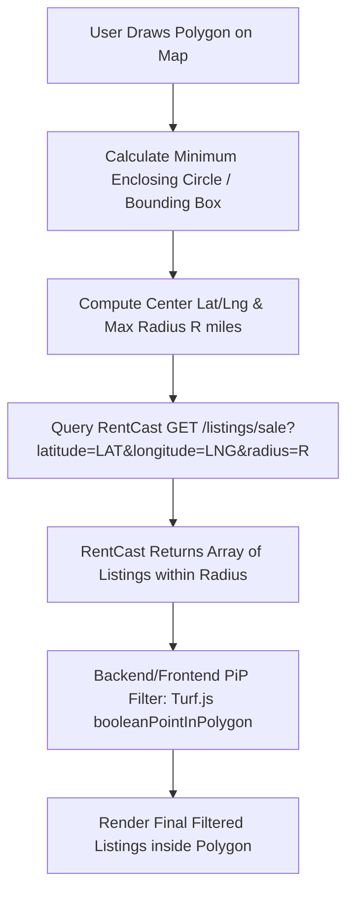

# RentCast API Technical Research Report

**Date:** August 24, 2026  
**Target Application:** Realtor Platform  
**File Location:** `Product/rentcast-api-report.md`  

---

## 1. Executive Overview & Authentication

The **RentCast API** provides real-time and historical nationwide real estate data for over 150 million properties across the United States. It offers property records, active and past sale/rental listings, automated valuation models (AVM), and aggregate local market analytics.

### Base Specifications
* **Base URL:** `https://api.rentcast.io/v1`
* **Protocol:** HTTPS GET / JSON Response
* **Authentication:** API Key passed in the request header:
  ```http
  X-Api-Key: YOUR_API_KEY
  ```
* **Content-Type:** `application/json`
* **Default Sorting:** Listings endpoints automatically sort results by `lastSeenDate` in descending order (most recent first).
* **Pagination:** Up to 500 records per response payload using `limit` and `offset` query parameters.

---

## 2. Available API Endpoints Inventory

The RentCast API API consists of 6 primary endpoint categories:

| Endpoint | Method | Description |
| :--- | :--- | :--- |
| `/properties` | `GET` | Bulk search or lookup property attribute records (structural data, owner details, tax assessments). |
| `/properties/{id}` | `GET` | Retrieve detailed property record by internal RentCast property ID. |
| `/listings/sale` | `GET` | Search active and inactive for-sale property listings by location and property filters. |
| `/listings/sale/{id}` | `GET` | Retrieve a specific sale listing record by ID. |
| `/listings/rental/long-term` | `GET` | Search active and inactive long-term rental property listings. |
| `/listings/rental/long-term/{id}` | `GET` | Retrieve a specific rental listing record by ID. |
| `/avm/value` | `GET` | Calculate Automated Valuation Model (AVM) sale price estimates and comparable sales. |
| `/avm/rent/long-term` | `GET` | Calculate AVM long-term rent estimates and comparable rental listings. |
| `/markets` | `GET` | Retrieve aggregate real estate market data, trends, and statistics by zip code. |

---

## 3. For-Sale Property Search & Polygon Filtering Analysis

### A. Searching For-Sale Properties (`GET /listings/sale`)
The RentCast API features a dedicated endpoint for searching for-sale properties: `GET /listings/sale`.

#### Supported Search Criteria & Parameters:
1. **Location Query Parameters:**
   * `address` *(string)*: Specific property address or address search string.
   * `city` *(string)*: City name.
   * `state` *(string)*: 2-character state code (e.g. `CA`, `TX`).
   * `zipCode` *(string)*: 5-digit US Zip Code.
   * `latitude` *(number)* & `longitude` *(number)*: Center point for geographic radius searches.
   * `radius` *(number)*: Radius distance in miles around `latitude`/`longitude` or `address` (e.g. `radius=5`).

2. **Attribute & Price Filter Criteria:**
   * `propertyType` *(enum/string)*: Filter by type (`Single Family`, `Condo`, `Townhouse`, `Manufactured`, `Multi-Family`, `Apartment`, `Land`). Supports OR selection via `|` (e.g. `Condo|Townhouse`).
   * `bedrooms` *(string)*: Number of bedrooms. Supports ranges (`min:max`), lists (`2|3|4`), or studio (`0`).
   * `bathrooms` *(string)*: Number of bathrooms. Supports ranges (`1:2.5`) or lists (`2|3`).
   * `price` *(string)*: Listed price range (e.g. `250000:600000` or `*:500000`).
   * `squareFootage` *(string)*: Living area size in sq ft range (e.g. `1500:3000`).
   * `yearBuilt` *(string)*: Year built range (e.g. `1990:2024`).
   * `status` *(enum)*: Listing status (`Active` or `Inactive`). Default is `Active`.
   * `daysOld` *(number)*: Filter listings modified or listed within the last N days (e.g. `daysOld=14`).
   * `limit` *(number)*: Pagination limit (1 to 500, default 500).
   * `offset` *(number)*: Pagination offset (default 0).

---

### B. Polygon Geo-Filtering Evaluation

> [!IMPORTANT]
> **Does RentCast API support searching based on Geo Polygons natively?**  
> **NO.** RentCast API **does not** accept GeoJSON polygons, WKT geometries, or custom bounding coordinate vertices in request parameters.

#### Native Geographic Search Support:
* **Circular Radius Search:** RentCast natively supports circular geographic searches using `latitude`, `longitude`, and `radius` (in miles).
* **Administrative Boundaries:** Search by `city`, `state`, or `zipCode`.

#### Recommended Solution: Hybrid Bounding Circle + Point-in-Polygon (PiP) Post-Filtering

To enable user-drawn polygon searches in the Realtor application using RentCast API, implement a 2-step architecture:



1. **Step 1: Calculate Bounding Geometry (Center & Radius)**
   * When a user creates or selects a polygon boundary, compute the centroid $(\text{lat}_c, \text{lng}_c)$ and maximum distance $R$ (in miles) from the centroid to any vertex on the polygon.
2. **Step 2: Fetch Candidate Set from RentCast**
   * Call `GET /listings/sale?latitude=lat_c&longitude=lng_c&radius=R&price=...` to retrieve all listings in the enclosing circle.
3. **Step 3: Point-in-Polygon Filter**
   * Filter the returned listings using `@turf/boolean-point-in-polygon` (or equivalent GeoJSON library) by checking if `[listing.longitude, listing.latitude]` resides inside the defined polygon.

---

## 4. Request & Response Object Specifications

### A. Special Query Parameter Filter Syntax
* **Numeric Ranges (`:`):** `min:max` format. Use `*` for unbounded limits.
  * Example: `price=300000:750000`
  * Example: `squareFootage=1200:*` (1200+ sq ft)
* **Multiple Values / OR Filter (`|`):** Pipe-delimited string.
  * Example: `propertyType=Single Family|Condo|Townhouse`
  * Example: `bedrooms=3|4|5`

---

### B. Sale Listing Object Schema (`GET /listings/sale`)

#### Request Example (cURL):
```bash
curl --request GET \
  --url 'https://api.rentcast.io/v1/listings/sale?latitude=30.2672&longitude=-97.7431&radius=5&propertyType=Single%20Family%7CCondo&price=250000%3A650000&status=Active&limit=50' \
  --header 'Accept: application/json' \
  --header 'X-Api-Key: YOUR_API_KEY'
```

#### Response Object Structure (`ListingSale`):
```json
[
  {
    "id": "sale_lst_987654321",
    "formattedAddress": "1234 Main St, Austin, TX 78701",
    "addressLine1": "1234 Main St",
    "addressLine2": null,
    "city": "Austin",
    "state": "TX",
    "zipCode": "78701",
    "county": "Travis",
    "stateFips": "48",
    "countyFips": "48453",
    "latitude": 30.2672,
    "longitude": -97.7431,
    "propertyType": "Single Family",
    "bedrooms": 3,
    "bathrooms": 2.5,
    "squareFootage": 2100,
    "lotSize": 7500,
    "yearBuilt": 2018,
    "status": "Active",
    "price": 549000,
    "listingDate": "2026-08-01T12:00:00.000Z",
    "dateRemoved": null,
    "lastSeenDate": "2026-08-24T08:30:00.000Z",
    "daysOnMarket": 23,
    "listingType": "Standard",
    "mlsName": "ACTRIS",
    "mlsNumber": "MLS1234567",
    "hoa": {
      "fee": 150,
      "period": "Monthly"
    },
    "listingAgent": {
      "name": "Jane Doe",
      "phone": "512-555-0199",
      "email": "janedoe@realty.com",
      "website": "https://janedoerealty.com"
    },
    "listingOffice": {
      "name": "Austin Premier Realty",
      "phone": "512-555-0100",
      "email": "info@austinpremierrealty.com"
    },
    "history": {
      "2026-08-01": {
        "event": "Listed",
        "price": 549000
      }
    }
  }
]
```

---

### C. Property Record Object Schema (`GET /properties`)

#### Request Example (cURL):
```bash
curl --request GET \
  --url 'https://api.rentcast.io/v1/properties?address=1234%20Main%20St%2C%20Austin%2C%20TX%2078701' \
  --header 'Accept: application/json' \
  --header 'X-Api-Key: YOUR_API_KEY'
```

#### Response Object Structure (`PropertyRecord`):
```json
[
  {
    "id": "prop_123456789",
    "formattedAddress": "1234 Main St, Austin, TX 78701",
    "addressLine1": "1234 Main St",
    "addressLine2": null,
    "city": "Austin",
    "state": "TX",
    "zipCode": "78701",
    "county": "Travis",
    "latitude": 30.2672,
    "longitude": -97.7431,
    "propertyType": "Single Family",
    "bedrooms": 3,
    "bathrooms": 2.5,
    "squareFootage": 2100,
    "lotSize": 7500,
    "yearBuilt": 2018,
    "assessedValue": 480000,
    "taxAmount": 9600,
    "ownerName": "John & Jane Smith",
    "ownerType": "Individual",
    "lastSaleDate": "2021-05-15T00:00:00.000Z",
    "lastSalePrice": 450000
  }
]
```

---

### D. Automated Valuation Model (AVM) Object Schema (`GET /avm/value`)

#### Request Example (cURL):
```bash
curl --request GET \
  --url 'https://api.rentcast.io/v1/avm/value?address=1234%20Main%20St%2C%20Austin%2C%20TX%2078701&lookupSubjectAttributes=true' \
  --header 'Accept: application/json' \
  --header 'X-Api-Key: YOUR_API_KEY'
```

#### Response Object Structure (`AVMValue`):
```json
{
  "price": 552000,
  "priceRangeLow": 510000,
  "priceRangeHigh": 594000,
  "subjectProperty": {
    "id": "prop_123456789",
    "formattedAddress": "1234 Main St, Austin, TX 78701",
    "bedrooms": 3,
    "bathrooms": 2.5,
    "squareFootage": 2100,
    "propertyType": "Single Family"
  },
  "comparables": [
    {
      "id": "comp_1",
      "formattedAddress": "1240 Main St, Austin, TX 78701",
      "price": 545000,
      "distance": 0.08,
      "correlation": 0.95,
      "bedrooms": 3,
      "bathrooms": 2.5,
      "squareFootage": 2050,
      "listedDate": "2026-07-10T00:00:00.000Z"
    }
  ]
}
```

---

### E. Aggregate Market Statistics Object Schema (`GET /markets`)

#### Request Example (cURL):
```bash
curl --request GET \
  --url 'https://api.rentcast.io/v1/markets?zipCode=78701&historyRange=12' \
  --header 'Accept: application/json' \
  --header 'X-Api-Key: YOUR_API_KEY'
```

#### Response Object Structure (`MarketStatistics`):
```json
{
  "zipCode": "78701",
  "lastUpdatedDate": "2026-08-01T00:00:00.000Z",
  "rentalData": {
    "averageRent": 2850,
    "minRent": 1600,
    "maxRent": 6500,
    "totalListings": 142
  },
  "saleData": {
    "averagePrice": 620000,
    "minPrice": 280000,
    "maxPrice": 1850000,
    "averageDaysOnMarket": 31,
    "totalListings": 89
  }
}
```

---

## 5. Architectural & Implementation Strategy for Realtor

### Integration Blueprint in Realtor Full-Stack App
1. **Backend Integration (`realtor/` - Node.js / Express / GraphQL)**:
   * Create a dedicated service module `RentCastService.ts` to wrap HTTP calls to `api.rentcast.io`.
   * Implement GraphQL resolvers for `searchPropertiesForSale(filter: SalePropertyFilterInput!): [PropertyListing!]!`.
   * Add bounding circle computation and Turf.js point-in-polygon filtering inside the backend resolver before returning data to the frontend.

2. **Caching & Rate Limit Protection**:
   * RentCast enforces monthly request quotas based on plan tier.
   * Store fetched property/listing results in MongoDB (`Mongoose`) with TTL index (e.g. 24-hour cache) using `formattedAddress` or `id` as primary keys to reduce redundant API calls and lower costs.

---

## 6. Summary Checklist & Answers to Key Questions

* **Available Calls:** 6 main endpoint categories (`/properties`, `/listings/sale`, `/listings/rental/long-term`, `/avm/value`, `/avm/rent/long-term`, `/markets`).
* **Is there a call searching for sale properties by filter & geo polygon?** 
  * Searching for sale properties is fully supported via `GET /listings/sale` with rich filter criteria (`price`, `bedrooms`, `bathrooms`, `propertyType`, `squareFootage`, `daysOld`, `status`).
  * **Polygon geo-search is NOT directly supported** by RentCast. To support custom polygon boundaries, use a 2-step approach: fetch listings using the enclosing circle (`latitude`, `longitude`, `radius`), then filter results using Point-in-Polygon logic (Turf.js).
* **Request & Response Objects:** Complete JSON schemas, cURL request examples, parameter rules, and response data objects are fully documented in Section 4 above.
* **Report Location:** Saved directly to `Product/rentcast-api-report.md`.
